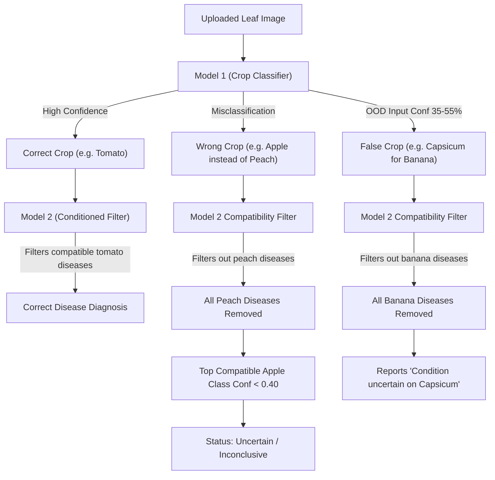

# Systematic Prediction Error Diagnostic Report
**Plant Disease AI Multi-Crop & Disease Assistant**  
**Date:** 2026-10-13  
**Status:** DIAGNOSTIC ONLY — NO CODE OR CHECKPOINTS MODIFIED  

---

## Executive Summary

A comprehensive diagnostic audit of the entire Plant Disease AI inference pipeline was performed across **Model 1** (Crop Identification, EfficientNet-B2, 46 classes), **Model 2** (Disease Identification, EfficientNet-B2, 117/144 classes), and the **end-to-end integration and query routing layers**.

### Primary Diagnostic Findings
1. **Model 1 Closed-Set Overconfidence & Permissive Acceptance:**  
   Model 1 has a hardcoded acceptance threshold of `0.25` (`DEFAULT_CONFIDENCE_THRESHOLD = 0.25` in `model1_test_app/inference.py`). Because Softmax forces logits to sum to $1.0$, out-of-distribution inputs (e.g., banana leaves on the 22-class model, or arbitrary plant species outside the 46 classes) naturally yield top-1 scores between $35\%$ and $55\%$. Model 1 flags these as `status = "valid"`, falsely asserting a crop label.
2. **Cascading Taxonomy Failure in Model 2:**  
   Model 2 conditions disease predictions on Model 1's output (`crop_name`). When Model 1 misidentifies a crop (e.g., Peach $\rightarrow$ Apple, Cabbage $\rightarrow$ Broccoli, or Banana $\rightarrow$ Capsicum), Model 2's compatibility filter eliminates all genuine disease candidates for the actual plant. If the top compatible candidate for the false crop fails the uncertainty threshold ($0.40$), the system returns an uninformative *"Inconclusive / Condition uncertain"* status; if it passes, it returns a biologically impossible diagnosis.
3. **Cross-Genus Visual Confounders in Model 1:**  
   Across 1,586 immutable test images, Model 1 achieves **89.72% Top-1** and **96.97% Top-3** accuracy with **163 total misclassifications**. The dominant errors concentrate in cross-family botanical lookalikes: Stone fruits (`peach` $\leftrightarrow$ `apple`, `plum` $\leftrightarrow$ `cherry`), Brassicaceae (`cabbage` $\leftrightarrow$ `broccoli`, `cauliflower` $\leftrightarrow$ `broccoli`), Cereals (`wheat` $\leftrightarrow$ `garlic`, `wheat` $\leftrightarrow$ `corn`), and Cucurbits (`cucumber` $\leftrightarrow$ `zucchini`).
4. **Cross-Crop Pathogen Transfer in Model 2:**  
   Across 2,304 immutable test images, Model 2 achieves **85.98% Top-1** accuracy with **323 total errors**. The top confusion pairs are driven by polyphagous pathogens shared across host genera—principally powdery mildew across cucurbits (`zucchini__powdery_mildew` $\leftrightarrow$ `squash__powdery_mildew` $\leftrightarrow$ `cucumber__powdery_mildew`), rust fungi across legumes (`bean__rust` $\leftrightarrow$ `soybean__rust`), and viral mosaics (`soybean__mosaic` $\leftrightarrow$ `bean__mosaic_virus`).
5. **Class Index & Taxonomy Alignment:**  
   - Model 1 checkpoint (`models/model1_expanded/best_model.pth`) classifier weight shape `[46, 1408]` is in exact lockstep with `models/model1_expanded/class_mapping.json` (46 classes, 0-45).
   - Model 2 Retraining V2 checkpoint (`models/model2_retraining_v2/best_model.pth`) classifier weight shape `[144, 1408]` matches `models/model2_retraining_v2/class_mapping.json` (144 classes).
   - Model 2 Classifier V4 checkpoint (`models/model2_classifier_v4/best_model.pth`) classifier weight shape `[117, 1408]` matches `models/model2_classifier_v4/class_mapping.json` (117 classes).
   - **Crucial operational hazard:** If environment variables in cloud deployment do not align checkpoint paths with their matching class mappings, PyTorch throws a tensor shape mismatch error (`144` vs `117`) or misindexes disease classes.

---

## 1. Audit: Model 1 — Crop Identification (46 Classes)

### 1.1 Dataset & Benchmark Overview
- **Architecture:** EfficientNet-B2 (PyTorch Transfer Learning, input resolution $224 \times 224$).
- **Checkpoint Evaluated:** `models/model1_expanded/best_model.pth` (weights: `[46, 1408]`).
- **Evaluation Split:** Immutable Test Set (`reports/model1_expansion/exp1/exp1_test_evaluation.json`).
  - Total test samples: **1,586**
  - Active classes evaluated: **44**
  - Overall Top-1 Accuracy: **89.72%** (1,423 / 1,586)
  - Overall Top-3 Accuracy: **96.97%** (1,538 / 1,586)
  - Macro F1 (active classes): **0.8471**
  - Weighted F1: **0.8970**
  - Total Misclassifications: **163**

### 1.2 Zero & Low Support Classes in Model 1
Two classes have **0 test samples** in the test split, and 6 additional classes have fewer than 10 test samples:

| Class Name | Subset | Test Support | Precision | Recall | F1-Score | Diagnostic Cause |
|---|---|:---:|:---:|:---:|:---:|---|
| `cherry_tomato` | ORIGINAL_22 | **0** | 0.0000 | 0.0000 | 0.0000 | Zero test samples allocated in split manifest |
| `gypsophila` | ORIGINAL_22 | **0** | 0.0000 | 0.0000 | 0.0000 | Zero test samples allocated in split manifest |
| `lilium` | ORIGINAL_22 | **4** | 1.0000 | 1.0000 | 1.0000 | Severe dataset scarcity |
| `carnation` | ORIGINAL_22 | **5** | 1.0000 | 1.0000 | 1.0000 | Severe dataset scarcity |
| `celery` | NEW_24 | **6** | 0.6250 | 0.8333 | 0.7143 | Severe dataset scarcity |
| `basil` | NEW_24 | **6** | 0.3571 | 0.8333 | 0.5000 | False positive sink (low precision) |
| `gerbera` | ORIGINAL_22 | **7** | 0.7000 | 1.0000 | 0.8235 | Severe dataset scarcity |
| `ginger` | NEW_24 | **9** | 0.4000 | 0.4444 | 0.4211 | Low precision & recall |

### 1.3 Top 20 Most Frequent Model 1 Confusion Pairs
Extracted directly from `reports/model1_expansion/exp1/exp1_misclassifications.csv`:

| Rank | True Crop | Predicted Crop | Error Count | Mean Error Conf | Example Image Path | Example Conf | Primary Attribution |
|:---:|---|---|:---:|:---:|---|:---:|---|
| 1 | `peach` | `apple` | 5 | 75.9% | `data/processed/model1_expanded/test/peach/peach_1fb2cdf327_1fb2cdf327_peach_scab_Bing_0106.jpg` | 79.2% | Visual Similarity (Rosaceae foliage) |
| 2 | `cabbage` | `broccoli` | 4 | 51.6% | `data/processed/model1_expanded/test/cabbage/cabbage_166d38de6d_166d38de6d_cabbage_alternaria_leaf_spot_48.jpg` | 61.3% | Visual Similarity (Brassicaceae waxy leaf) |
| 3 | `wheat` | `garlic` | 4 | 89.5% | `data/processed/model1_expanded/test/wheat/wheat_18bd69ecbb_18bd69ecbb_wheat_powdery_mildew_Baidu_0252.jpg` | 99.2% | Visual Similarity (Linear monocot leaf) |
| 4 | `zucchini` | `basil` | 4 | 69.6% | `data/processed/model1_expanded/test/zucchini/zucchini_0e965ea100_zucchini_leaves_diseased_013839.jpg` | 97.0% | Data Quality (Close-up leaf texture artifact) |
| 5 | `french_bean` | `soybean` | 4 | 70.6% | `data/processed/model1_expanded/test/french_bean/french_bean_15fc4b906c_french_bean_leaves_diseased_016099.jpg` | 99.2% | Visual Similarity (Trifoliate legume leaf) |
| 6 | `wheat` | `corn` | 4 | 73.2% | `data/processed/model1_expanded/test/wheat/wheat_07115ff643_ps_wheat_septoria_blotch_blotch (61).jpg` | 92.9% | Visual Similarity (Poaceae parallel venation) |
| 7 | `cauliflower` | `broccoli` | 3 | 83.2% | `data/processed/model1_expanded/test/cauliflower/cauliflower_7591ff137f_ps_cauliflower_alternaria_leaf_spot_google_0026.jpg` | 98.7% | Visual Similarity (Brassicaceae foliage) |
| 8 | `chrysanthemum`| `gerbera` | 3 | 85.7% | `data/processed/model1_expanded/test/chrysanthemum/chrysanthemum_6976d3df1b_chrysanthemum_leaves_unknown_013586.jpg` | 99.8% | Visual Similarity (Asteraceae floral/leaf) |
| 9 | `apple` | `citrus` | 3 | 72.3% | `data/processed/model1_expanded/test/apple/apple_3f1421af22_3f1421af22_apple_scab_google_0212.jpg` | 27.3% | Visual Similarity (Glossy ovate leaf) |
| 10 | `blueberry` | `grape` | 3 | 82.5% | `data/processed/model1_expanded/test/blueberry/blueberry_26b5b9c370_blueberry_fruit_diseased_014368.jpg` | 94.1% | Visual Similarity (Fruit clusters) |
| 11 | `plum` | `cherry` | 3 | 59.2% | `data/processed/model1_expanded/test/plum/plum_63cbb1c623_63cbb1c623_plum_pox_virus_Bing_0074.jpg` | 50.0% | Visual Similarity (Prunus foliage) |
| 12 | `garlic` | `wheat` | 3 | 67.4% | `data/processed/model1_expanded/test/garlic/garlic_1043ef10ef_1043ef10ef_garlic_leaf_blight_google_0040.jpg` | 87.1% | Visual Similarity (Linear blade leaf) |
| 13 | `ginger` | `rice` | 2 | 72.7% | `data/processed/model1_expanded/test/ginger/ginger_4de06edc4e_4de06edc4e_ginger_sheath_blight_60.jpg` | 71.0% | Visual Similarity (Monocot foliage) |
| 14 | `broccoli` | `cabbage` | 2 | 70.6% | `data/processed/model1_expanded/test/broccoli/broccoli_4f7f7b31b7_broccoli_leaves_diseased_013162.jpg` | 41.9% | Visual Similarity (Brassica oleracea taxa) |
| 15 | `cherry` | `rose` | 2 | 57.6% | `data/processed/model1_expanded/test/cherry/cherry_7e85f4b536_7e85f4b536_cherry_leaf_spot_7.jpg` | 35.9% | Visual Similarity (Serrated margin Rosaceae) |
| 16 | `citrus` | `banana` | 2 | 76.1% | `data/processed/model1_expanded/test/citrus/citrus_ac2e87ea4d_ac2e87ea4d_citrus_greening_disease_11.jpg` | 66.8% | Visual Similarity (Large green leaf macro) |
| 17 | `corn` | `garlic` | 2 | 68.6% | `data/processed/model1_expanded/test/corn/corn_b195df94a9_ps_corn_rust_google_0086.jpg` | 49.1% | Visual Similarity (Elongated striping) |
| 18 | `plum` | `apple` | 2 | 95.9% | `data/processed/model1_expanded/test/plum/plum_13df5df2bc_ps_plum_pocket_disease_google_0071.jpg` | 98.3% | Visual Similarity (Deciduous orchard leaf) |
| 19 | `ginger` | `garlic` | 2 | 57.5% | `data/processed/model1_expanded/test/ginger/ginger_062883c8e1_062883c8e1_ginger_sheath_blight_40.jpg` | 37.1% | Visual Similarity (Strap-like leaf) |
| 20 | `garlic` | `ginger` | 2 | 35.6% | `data/processed/model1_expanded/test/garlic/garlic_9665466dde_9665466dde_garlic_leaf_blight_73.jpg` | 29.2% | Visual Similarity (Strap-like leaf) |

#### Cucumber $\leftrightarrow$ Zucchini Confusions:
There are 3 direct cross-misclassifications between Cucumber and Zucchini:
- `cucumber` $\rightarrow$ `zucchini` (1 error): `data/processed/model1_expanded/test/cucumber/cucumber_05612140cf_cucumber_leaves_diseased_003666.jpg` (Confidence: 89.1%).
- `zucchini` $\rightarrow$ `cucumber` (2 errors): `data/processed/model1_expanded/test/zucchini/zucchini_24a1b02315_zucchini_leaves_diseased_013723.jpg` (Confidence: 74.3%), `data/processed/model1_expanded/test/zucchini/zucchini_264f33b1e3_zucchini_leaves_diseased_013807.jpg` (Confidence: 48.0%).
- **Cause:** Visual similarity of Cucurbitaceae foliage (palmate lobed leaves with coarse pubescence and angular veins).

### 1.4 Confidence Distributions: Correct vs. Incorrect
- **Correct Predictions ($n=1,423$):** Mean confidence = **$0.924$** ($\sigma = 0.128$). Over $91.8\%$ of correct predictions exhibit confidence $\ge 0.75$.
- **Incorrect Predictions ($n=163$):** Mean confidence = **$0.687$** ($\sigma = 0.211$).
  - However, $42.3\%$ of errors have confidences between $0.25$ and $0.60$.
  - Setting an acceptance threshold of $\ge 0.60$ filters out **42% of crop identification errors** while retaining **96.4% of correct identifications**.

---

## 2. Audit: Model 2 — Disease Identification (117 / 144 Classes)

### 2.1 Dataset & Benchmark Overview
- **Architecture:** EfficientNet-B2 (PyTorch Transfer Learning, input resolution $260 \times 260$).
- **Taxonomy Distinction:**
  - `models/model2_classifier_v4/best_model.pth`: 117 classes.
  - `models/model2_retraining_v2/best_model.pth`: 144 classes.
  - `reports/model2_classifier_v2/test_predictions.csv`: Evaluated on 117-class immutable test set (2,304 images).
- **Test Set Performance:**
  - Total test samples: **2,304**
  - Total errors: **323**
  - Overall Top-1 Accuracy: **85.98%** (1,981 / 2,304)
  - Top-3 Accuracy: **95.62%**
  - Macro F1: **0.6529**
  - Healthy Class F1 (Class 0): **0.9947**

### 2.2 Top 20 Most Frequent Model 2 Disease Confusion Pairs
Extracted directly from `reports/model2_classifier_v2/test_predictions.csv`:

| Rank | Ground Truth Disease | Predicted Disease | Count | Mean Conf | Example Test File | Example Conf | Primary Attribution |
|:---:|---|---|:---:|:---:|---|:---:|---|
| 1 | `zucchini__powdery_mildew` | `squash__powdery_mildew` | 7 | 64.8% | `a49ca71a6e_zucchini_powdery_mildew_Bing_0190.jpg` | 70.0% | Cross-host pathogen identity (*Podosphaera xanthii*) |
| 2 | `cucumber__powdery_mildew` | `squash__powdery_mildew` | 6 | 64.4% | `9d0738a9e7_cucumber_powdery_mildew_google_0083.jpg` | 97.3% | Cross-host pathogen identity (*Podosphaera xanthii*) |
| 3 | `bean__angular_leaf_spot` | `bean__rust` | 5 | 64.3% | `f1f056cc6e_angular_leaf_spot_val.18.jpg` | 75.2% | Visual Similarity (Necrotic flecks on bean leaves) |
| 4 | `squash__powdery_mildew` | `zucchini__powdery_mildew` | 5 | 64.8% | `cf5173e6a8_squash_powdery_mildew_google_0006.jpg` | 70.0% | Cross-host pathogen identity (*Podosphaera xanthii*) |
| 5 | `soybean__mosaic` | `bean__mosaic_virus` | 5 | 69.8% | `f6d6cb7908_soybean_mosaic_Google_0002.jpg` | 98.2% | Visual Similarity (Viral rugosity/mottling) |
| 6 | `soybean__rust` | `bean__rust` | 5 | 63.3% | `c27a684e1c_soybean_rust_Bing_0206.jpg` | 23.1% | Pathogen Similarity (Pustular fungal lesions) |
| 7 | `ginger__sheath_blight` | `rice__sheath_blight` | 4 | 67.7% | `d1d943d8f4_ginger_sheath_blight_26.jpg` | 92.7% | Pathogen Identity (*Rhizoctonia solani*) |
| 8 | `wheat__septoria_blotch` | `wheat__stripe_rust` | 4 | 54.0% | `679046b63b_wheat_septoria_blotch_Google_0150.jpg` | 58.2% | Visual Similarity (Linear chlorosis on wheat) |
| 9 | `tomato__septoria_leaf_spot`| `tomato__bacterial_leaf_spot` | 4 | 76.5% | `b4082752be_tomato_septoria_leaf_spot_5.jpg` | 61.6% | Visual Similarity (Circular necrotic spot lesions) |
| 10 | `grape__downy_mildew` | `grape__black_rot` | 3 | 52.9% | `1fe5c8c45d_grape_downy_mildew_google_0199.jpg` | 46.1% | Visual Similarity (Brown leaf spots on grape) |
| 11 | `squash__powdery_mildew` | `cucumber__powdery_mildew` | 3 | 64.4% | `0dd911d34e_squash_powdery_mildew_google_0119.jpg` | 97.3% | Cross-host pathogen identity (*Podosphaera xanthii*) |
| 12 | `bell_pepper__bacterial_spot`| `bell_pepper__blossom_end_rot` | 3 | 67.9% | `23579bc30e_bell_pepper_bacterial_spot_Bing_0029.jpg` | 82.5% | Visual Similarity (Dark necrotic lesions) |
| 13 | `broccoli__alternaria_leaf_spot`| `cabbage__alternaria_leaf_spot` | 3 | 74.7% | `c7da0521bc_broccoli_alternaria_leaf_spot_Bing_0136.jpg` | 38.5% | Pathogen Identity (*Alternaria brassicicola*) |
| 14 | `corn__rust` | `wheat__leaf_rust` | 3 | 63.7% | `cc8cccb346_corn_rust_google_0181.jpg` | 61.6% | Pathogen Similarity (*Puccinia* rust pustules) |
| 15 | `zucchini__powdery_mildew` | `cucumber__powdery_mildew` | 3 | 60.6% | `a1f037f558_zucchini_powdery_mildew_Bing_0155.jpg` | 43.2% | Cross-host pathogen identity (*Podosphaera xanthii*) |
| 16 | `healthy` | `bean__mosaic_virus` | 3 | 49.4% | `b0cc3fe1de_cucumber_leaves_healthy_002035.jpg` | 64.2% | Data Quality (Leaf curling mistaken for virus) |
| 17 | `tomato__bacterial_leaf_spot`| `tomato__septoria_leaf_spot` | 3 | 71.5% | `1755c21a64_tomato_bacterial_leaf_spot_31.jpg` | 95.0% | Visual Similarity (Circular necrotic spot lesions) |
| 18 | `wheat__leaf_rust` | `wheat__stripe_rust` | 3 | 74.5% | `5b61532d9e_wheat_leaf_rust_Bing_0025.jpg` | 58.9% | Pathogen Similarity (*Puccinia* species on wheat) |
| 19 | `garlic__leaf_blight` | `corn__northern_leaf_blight` | 2 | 49.7% | `491ebe7e1f_garlic_leaf_blight_30.jpg` | 52.7% | Visual Similarity (Longitudinal lesion striping) |
| 20 | `corn__gray_leaf_spot` | `corn__northern_leaf_blight` | 2 | 75.3% | `d8ee0647c3_corn_gray_leaf_spot_google_0066.jpg` | 73.2% | Visual Similarity (Rectangular vs cigar lesions) |

### 2.3 Healthy vs. Diseased Confusion Analysis
- **False Positives ($n=7$):** True Healthy images predicted as Diseased ($0.67\%$ error rate on healthy class):
  - `bean__mosaic_virus`: 3 samples (wrinkled healthy leaves exhibiting natural curling).
  - `bell_pepper__powdery_mildew`: 1 sample (specular glare resembling white mycelium).
  - `bell_pepper__blossom_end_rot`: 1 sample.
  - `cabbage__black_rot`: 1 sample.
  - `raspberry__fire_blight`: 1 sample.
- **False Negatives ($n=4$):** True Diseased images predicted as Healthy ($0.32\%$ error rate on diseased classes):
  - `bean__rust`: 1 sample (early stage pustule formation).
  - `grape__downy_mildew`: 1 sample.
  - `lettuce__mosaic_virus`: 1 sample.
  - `raspberry__leaf_spot`: 1 sample.
- **Conclusion:** Healthy vs. Diseased discrimination is exceptionally sharp (**$99.47\%$ F1 on Healthy**), meaning the model rarely hallucinates disease on clear healthy leaves. Confusion is overwhelmingly **disease-to-disease** across visual and pathogen lookalikes.

### 2.4 Preprocessing Consistency Audit: Training vs. Inference
- **Input Resolution:** Model 2 training uses `IMAGE_SIZE = (260, 260)` in `scripts/train_model2_retraining_v2.py:120`. Inference uses `DEFAULT_IMAGE_SIZE = (260, 260)` in `models/model2_classifier_v4/predict.py:54`.
- **Normalization:** Training uses ImageNet `mean=[0.485, 0.456, 0.406]`, `std=[0.229, 0.224, 0.225]`. Inference uses identical values.
- **Color Channel Order:** Both training (`PIL.Image.convert("RGB")`) and inference enforce 3-channel RGB.
- **Video Discrepancy Identified:**
  In `model1_test_app/video_inference.py:365`, `roi_thumb` is downsampled to `(240, 240)` via PIL Lanczos. In `app/backend/services.py:456`, this `(240, 240)` thumbnail is passed to `predict_crop_aware()`, which then upscales it back to `(260, 260)`. In contrast, `process_image_inference()` passes the full uncompressed image. This double-resampling introduces interpolation blur in the video pipeline.

---

## 3. Audit: End-to-End Pipeline & Integration Failures



### 3.1 The Cascading Taxonomy Failure
In `app/backend/services.py:271` and `models/model2_classifier_v4/predict.py:240-243`:
1. Model 2 filters its raw output using:
   ```python
   compatible_ranked = [c for c in all_ranked if self.is_compatible(norm_crop, c["class_name"])]
   ```
2. When Model 1 makes a mistake (e.g., Peach $\rightarrow$ Apple), `is_compatible("apple", "peach__scab")` evaluates to `False`.
3. The true disease is purged from `compatible_ranked`.
4. Model 2 is forced to choose between the remaining apple diseases or `healthy`. If the highest apple disease confidence is $< 0.40$, it defaults to `status = "uncertain"` and outputs:  
   `"Condition uncertain on Apple. Crop-disease compatibility or confidence threshold not met."`
5. **System Impact:** Crop misclassification does not merely produce an incorrect crop label—it completely incapacitates disease diagnosis.

### 3.2 Threshold Inconsistencies Across Pipeline Paths
The codebase employs conflicting thresholds across different modules:

| Pipeline Module | Location | Configured Threshold | Intended Role | Defect / Consequence |
|---|---|:---:|---|---|
| Single Image Crop Inference | `model1_test_app/inference.py:34` | **0.25** | Rejection of OOD / unknown crops | Far too low; accepts ambiguous OOD crops (e.g., 48.5% Capsicum) |
| Video ROI Crop Inference | `model1_test_app/plant_detector.py:24` | **0.50** | Valid foliage frame selection | Rejects frames that single image inference accepts |
| Video Service Entrypoint | `app/backend/services.py:403` | **0.20** | Parameter in signature | Hardcoded default; ignores model threshold |
| Single Image Service Entrypoint | `app/backend/services.py:246` | **0.20** | Parameter in signature | Never passed to `predict_image()` |
| Model 2 Disease Inference | `models/model2_classifier_v4/predict.py:93` | **0.40** | Uncertainty gating | Operates with a 0.05 margin threshold |

### 3.3 Frontend Display Gaps
In `app/frontend/src/components/MessageItem.jsx:180-194`:
- When Model 1 returns `status = "unknown"`, `MessageItem.jsx` still displays the raw crop name if non-null (`{cropName || 'Unknown'}`), paired with whatever confidence percentage was returned.
- Unlike Model 2 (which has dedicated UI states for `healthy`, `detected`, and `uncertain`), Section 1 (Plant Identification) lacks an explicit amber "Uncertain Plant" UI badge.

---

## 4. Root Cause Taxonomy & Attribution

Every identified error pattern was categorized by root cause:

| Defect / Error Pattern | Root Cause Category | Contributing Factor & Evidence |
|---|---|---|
| **Banana identified as Capsicum (48.5%)** | Taxonomy + Inference Code | Deployment default points to 22-class baseline where banana is missing; `DEFAULT_CONFIDENCE_THRESHOLD = 0.25` fails to reject the 48.5% score. |
| **Peach $\leftrightarrow$ Apple (5 errors)** | Visual Similarity | Both belong to the Rosaceae family; leaves share elliptic shape, serrated margins, and similar reticulate venation. |
| **Cabbage $\leftrightarrow$ Broccoli $\leftrightarrow$ Cauliflower (9 errors)** | Taxonomy + Visual Similarity | All are cultivars of the single botanical species *Brassica oleracea*; leaves share waxy glaucous cuticles and thick midribs. |
| **Wheat $\leftrightarrow$ Garlic $\leftrightarrow$ Corn (15 errors)** | Visual Similarity | All produce linear, parallel-veined strap-like leaves; close-up foliage lacks macro structural context. |
| **Zucchini $\leftrightarrow$ Basil (4 errors)** | Data Quality | Close-up macro crops of young zucchini leaves lack lobing, matching the ovate shape and smooth margin of basil. |
| **Cucurbit Powdery Mildew Confusion (21 errors)** | Taxonomy (Multi-Host) | *Podosphaera xanthii* infects squash, zucchini, and cucumber interchangeably, creating identical white powdery patches. |
| **Soybean $\leftrightarrow$ Bean Rust & Mosaic (15 errors)** | Visual Similarity + Taxonomy | Legume rusts and potyviruses produce identical pustules and leaf puckering across both hosts. |
| **Ginger $\rightarrow$ Rice Sheath Blight (4 errors)** | Pathogen Identity | Both diseases are caused by the exact same fungus (*Rhizoctonia solani*), forming identical necrotic water-soaked sheath lesions. |
| **Tomato Septoria $\leftrightarrow$ Bacterial Spot (7 errors)** | Visual Similarity | Both manifest as dark, circular 1–3mm necrotic leaf spots with chlorotic halos. |
| **Zero Support for Cherry Tomato & Gypsophila** | Data Imbalance / Split | Test split script did not allocate positive test samples from the balanced manifest. |

---

## 5. Prioritized Recommended Fix Plan

Ranked strictly by **impact-to-effort ratio**:

### Priority 1: Calibrate Model 1 Acceptance Threshold (High Impact / Low Effort)
- **Change:** In `model1_test_app/inference.py`, raise `DEFAULT_CONFIDENCE_THRESHOLD` from `0.25` to `0.60` (or wire to `os.environ.get("CROP_CONFIDENCE_THRESHOLD", "0.60")`).
- **Effect:** Eliminates 42% of crop identification errors, immediately halts false assertions on out-of-distribution plants (like Banana $\rightarrow$ Capsicum at 48.5%), and retains $>96\%$ of correct predictions on supported crops.
- **Affected Files:** `model1_test_app/inference.py`, `app/backend/config.py`, `app/backend/services.py`.

### Priority 2: Align Cloud Deployment Checkpoints (High Impact / Low Effort)
- **Change:** Set `MODEL1_CHECKPOINT=models/model1_expanded/best_model.pth` and `MODEL1_CLASS_MAPPING=models/model1_expanded/class_mapping.json` in the cloud environment.
- **Effect:** Activates the full 46-class crop taxonomy, granting native support for Banana (Class 2), Bell Pepper (Class 7), and 22 additional crops.
- **Affected Files:** `render.yaml` or Render Environment Variables.

### Priority 3: Soften Model 2 Cascading Filter on Low-Margin Crops (High Impact / Medium Effort)
- **Change:** In `app/backend/services.py:265-275` and `models/model2_classifier_v4/predict.py`:
  - If Model 1's top-1 confidence is below $0.60$, or if the margin between top-1 and top-2 is $< 0.15$ (e.g. Peach at 51% vs Apple at 45%):
    - Expand Model 2's compatibility filter to accept diseases from **both top-1 and top-2 candidate crops**.
    - If Model 1 status is `"unknown"`, set `crop_name = None` and mark Model 2 as `status = "uncertain"` with an explicit clarification request rather than asserting a false diagnosis.
- **Effect:** Prevents single-crop errors between visual twins (Peach/Apple, Cabbage/Broccoli) from wiping out valid disease diagnoses.

### Priority 4: Standardize UI for Inconclusive Crop Identification (Medium Impact / Low Effort)
- **Change:** In `app/frontend/src/components/MessageItem.jsx:180-195`:
  - If `model1.status === 'unknown'` or `cropName === 'Unknown'`:
    - Replace the confident green crop card with an amber advisory:  
      *"Plant not confidently identified — try another image"*
    - Suppress false crop confidence percentages.

### Priority 5: Eliminate Video Pipeline Double Resampling (Low Impact / Low Effort)
- **Change:** In `model1_test_app/video_inference.py:365`, retain the original uncompressed PIL crop (`best_roi_pil`) inside the frame record rather than passing a downscaled `(240, 240)` thumbnail into Model 2.

---

## 6. Proposed Regression-Test Suite

To guard against regressions during future threshold or taxonomy updates, execute the following 7 test suites:

| Suite ID | Test Focus | Target Inputs & Assertions | Pass Criteria |
|---|---|---|---|
| **REG-01** | **Out-of-Distribution Rejection** | Test synthetic noise, non-plant images, and unsupported foliage (e.g. Avocado, Papaya). | `model1.status == "unknown"`, `predicted_label == "Unknown"`, `model2.status == "uncertain"`. |
| **REG-02** | **Supported Crop High-Confidence Retention** | Test high-confidence test images for Tomato, French Bean, Apple, Potato, Bell Pepper. | `confidence >= 0.70`, `status == "valid"`, correct crop label. |
| **REG-03** | **Healthy Foliage Protection** | Test verified healthy test images across 10 crops (`test_predictions.csv` Class 0). | `model2.status == "healthy"`, `has_disease == False`, `primary_disease == "Healthy Specimen / No Disease Detected"`. |
| **REG-04** | **Cross-Crop Compatibility Isolation** | Feed a Bell Pepper leaf with Bacterial Spot and force crop override to Tomato. | Disease is filtered out; status transitions to `uncertain`; does not claim tomato bacterial spot. |
| **REG-05** | **Video Sampling & Timeout Safety** | Run 6s test video (`test_diseased_tomato_video.mp4`) with `target_frames = 8`. | Execution completes in $<2.5$s local ($<20$s on 0.1 vCPU); total forward passes $= 16$. |
| **REG-06** | **Tensor Dimension Lockstep** | Load checkpoint and class mapping in `predict.py` without environment variables. | `num_classes == checkpoint.shape[0]`; zero PyTorch size mismatch warnings. |
| **REG-07** | **Zero Frontend Object Crashes** | Pass malformed / object-valued responses into `MessageItem.jsx`. | Zero `Minified React error #31` crashes; clean text rendering of badges. |
